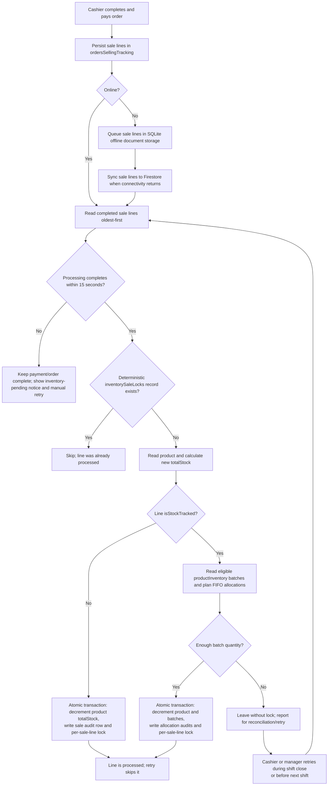

# Offline Reconciliation Flow

This flow documents the intended sale-line inventory workflow. A completed sale line in `ordersSellingTracking` is the inventory work source. It is not given a separate inventory status or copied to a separate request collection. Every completed sale decrements the product's `totalStock` and writes a deterministic `inventorySaleLocks` record. Stock-tracked products also use FIFO batch deductions; non-stock-tracked products skip FIFO but still write a sale audit row.

## Key collections involved
- `ordersSellingTracking` (completed sale lines and source work records; no inventory-status field is required)
- `inventorySaleLocks` (idempotency/completion marker per completed sale line; created in the same transaction as the product deduction and audit rows)
- `inventoryTracking` (stock-movement audit: one row per allocated FIFO batch for tracked products, or one sale row for non-stock-tracked products)
- `productInventory` (batch stock source of truth and FIFO deduction target)
- SQLite `offline_documents` (durable local copy of sale-line documents waiting to sync)
- `orderAccountingLedger`, `orderDetails`, and `reconciliationAuditLog` (accounting and broader reconciliation workflow)

## Notes
- Every completed sale decrements the product's `totalStock` and is protected by a deterministic sale-line lock, regardless of `isStockTracked`. When `isStockTracked === true`, validate available product and FIFO batch stock, then write one `inventoryTracking` row per allocation. When false, skip stock validation and FIFO, allow `totalStock` to go negative, and write one deterministic `eventType: 'sale'` audit row using the product's `costPrice` and `sellingPrice`, with `stockMovement: true`.
- `itemCode` identifies the product. A particular sale line is identified by its order and line index; locks and audit entries must not be keyed only by item code, because one product can be sold repeatedly.
- A line is processed only if its exact lock exists. The lock must be written atomically with the product quantity update and relevant batch updates/audit rows, so a failed transaction leaves the line retryable and a successful retry cannot deduct twice.
- FIFO can split a tracked sale line across several batches. Each allocation records that batch's `batchId`, document `refId`, quantity, unit cost, and sale-time selling price. Summing those allocation quantities for the exact sale line should equal the sold quantity.
- Inventory history reads non-stock-tracked sales from their `inventoryTracking` price snapshots. It suppresses the matching `ordersSellingTracking` row when an inventory-tracking record already represents that sale line, preventing duplicate report totals.
- Offline sales must first be durably saved as completed sale-line documents in SQLite. After sync, processing can read completed lines oldest-first and skip lines with an existing lock. If inventory cannot be processed, leave the line unlocked and report it for shift-close or next-shift reconciliation.
- Offline checkout queues sale-line records but does not read or deduct inventory. The reconnect sync triggers product-stock and, when applicable, FIFO processing after those lines reach Firestore.
- Online checkout waits up to 15 seconds for inventory processing. A timeout does not undo or repeat payment: it shows a pending notice with a manual inventory-only retry action. Deterministic locks make retry safe if the original transaction finishes late.
- The order-level inventory status is marked `applied` only after every sale line finishes without errors, not after the first line.
- This design does not use an `inventoryDeductionRequests` collection or an inventory-status field on `ordersSellingTracking`.
- Summary requests use the configured `reconciliationSummaryApi` and a Firebase ID token; a missing token or unsuccessful API response is reported to the user.
- Reconciliation searches and processing require connectivity. Offline capture itself must not depend on Firestore transactions.
