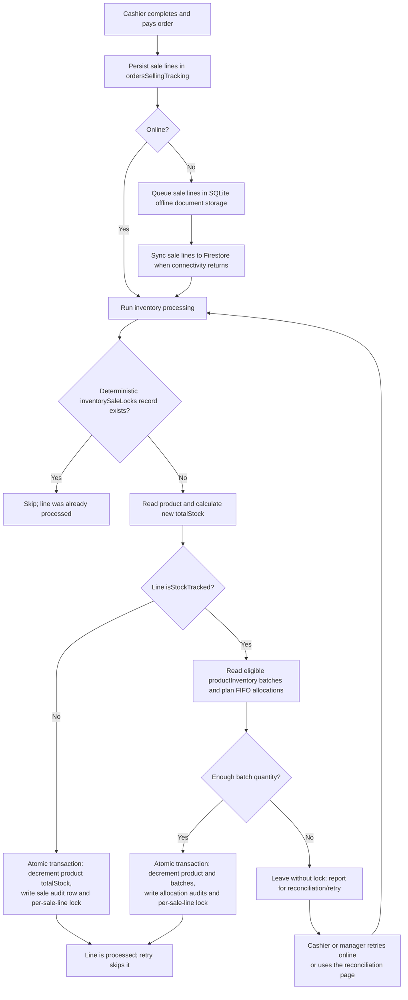

# Offline Sale and Inventory Reconciliation Flow

This flow documents how completed sale lines are captured offline, synced, and processed through FIFO. The invoice-level discrepancy page and manual repair steps are documented in [reconciliation-operations.md](reconciliation-operations.md).

## Key collections involved
- `ordersSellingTracking` (completed sale lines and source work records; no inventory-status field is required)
- `inventorySaleLocks` (idempotency/completion marker per completed sale line; created in the same transaction as the product deduction and audit rows)
- `inventoryTracking` (stock-movement audit: one row per allocated FIFO batch for tracked products, or one sale row for non-stock-tracked products)
- `productInventory` (batch stock source of truth and FIFO deduction target)
- SQLite `offline_documents` (durable local copy of sale-line documents waiting to sync)
- `orders` (invoice document; `inventoryStatus` is updated after processing completes without errors)
- `reconciliationAuditLog` (audit record for a successful manual repair from the reconciliation page)

## Notes
- Processing every completed sale decrements the product's `totalStock` and is protected by a deterministic sale-line lock, regardless of `isStockTracked`. Only an explicit `isStockTracked === true` enables stock validation and FIFO; false or missing values skip both and are not inferred from total stock or inventory batches. Tracked sales write one `inventoryTracking` row per allocation. Untracked sales allow `totalStock` to go negative and write one deterministic `eventType: 'sale'` audit row using the product's `costPrice` and `sellingPrice`, with `stockMovement: true`.
- Product creation and editing persist the selected `isStockTracked` value. The edit control remains changeable even when stock or batches exist; recomputing product summaries must not promote a false or missing flag. Creating a batch is an explicit inventory action and enables tracking.
- `itemCode` identifies the product. A particular sale line is identified by its order and line index; locks and audit entries must not be keyed only by item code, because one product can be sold repeatedly.
- The exact lock marks a sale line as successfully processed. The transaction writes it atomically with the product quantity update and relevant batch updates/audit rows, so a failed transaction leaves the line retryable and a retry after success cannot deduct twice.
- FIFO can split a tracked sale line across several batches. Each allocation records that batch's `batchId`, document `refId`, quantity, unit cost, and sale-time selling price. Summing those allocation quantities for the exact sale line should equal the sold quantity.
- Inventory history reads non-stock-tracked sales from their `inventoryTracking` price snapshots. It suppresses the matching `ordersSellingTracking` row when an inventory-tracking record already represents that sale line, preventing duplicate report totals.
- Offline sales must first be durably saved as completed sale-line documents in SQLite. Offline sync prioritizes order documents, remaps their IDs in related queued documents, and then notifies sale-line listeners after the sync pass. Eligible completed sale lines are processed oldest-first and skip lines with an existing lock. If inventory cannot be processed, it remains pending for an online retry or manual reconciliation.
- Offline checkout queues sale-line records but does not read or deduct inventory. The reconnect sync triggers product-stock and, when applicable, FIFO processing after those lines reach Firestore.
- Online checkout waits up to 15 seconds for inventory processing. A timeout does not undo or repeat payment: it shows a pending notice with a manual inventory-only retry action. The 15-second UI wait does not cancel an in-flight Firestore transaction; deterministic locks make retry safe if the original transaction finishes late. The offline reconnect listener does not use this UI timeout.
- The order-level inventory status is set to `applied` after pending-line processing returns without errors. A failure on a later line can happen after earlier line transactions have committed; check the processed count before retrying.
- This design does not use an `inventoryDeductionRequests` collection or an inventory-status field on `ordersSellingTracking`.
- The reconciliation page calls the configured summary API for invoice-level discrepancies and the details API for per-item quantities and inventory ledger rows. The **Fix inventory** action is shown for `NO_INVENTORY` details only; it requires internet, resolves the Firestore order, then runs the existing FIFO sale-line processor for all eligible tracked lines on that order. It may affect other items on the same invoice.
- The repair checks existing ledger quantities and locks to avoid duplicate deductions. Insufficient batches, partial ledger entries, or mismatches between the reporting API and Firestore can still require manual investigation. See [reconciliation-operations.md](reconciliation-operations.md) for the full runbook.
